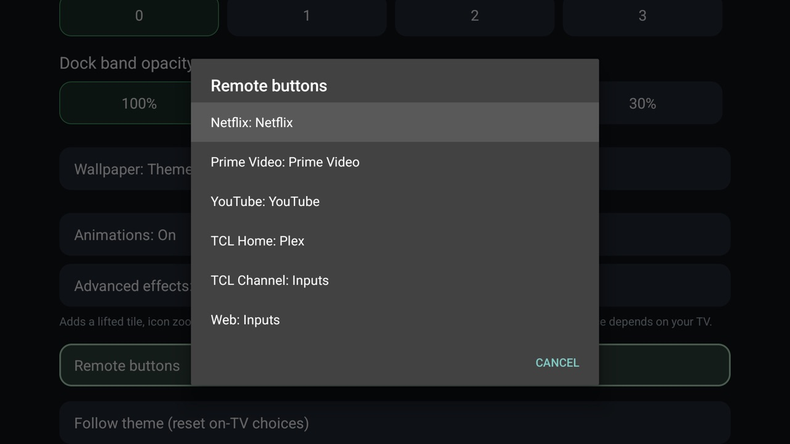

# This fork

[cleanyourtv](https://github.com/Gathin23/cleanyourtv)'s launcher with a few things added for a TCL 55C845X2
(Google TV 14, BT_RC833 remote). Everything else is the upstream repo, unchanged.



## What it adds

- **Remote buttons** (`remap_buttons`): Launcher settings lists the remote's app buttons, and each one can be set
  on the TV to an app or to Off, Inputs, Settings, Mute, Sleep or Screensaver, with ADB closed. A choice replaces
  that button's `app_keys` entry and survives a reinstall. Needs `HOME_KEY_SERVICE=1`. This was
  [PR #2263](https://github.com/Gathin23/cleanyourtv/pull/2263) upstream.
- **A Google TV style quick panel** on the remote's Settings button (`settings_key_panel`): the date and time, a
  gear for TV Settings, a Now playing card (artwork, title, Previous, Play/Pause, Next and progress; select it
  to go back to the app), tiles for Screensaver, Network, Display, Bluetooth, Audio output and Accessibility,
  and the TV's notifications (up to 6, newest first, with Clear all).
- **The music's artwork**: while an app plays music, its album art fills Home's background behind the tiles,
  and the clock screensaver too, with the title and artist under the date. It is darkened to the cover's
  brightness so the clock stays readable, and goes back to the wallpaper when the music pauses or stops.
- **TCL fixes**: the Screensaver action opens the launcher's clock when it is the chosen screensaver (TCL's
  firmware answers the system "start screensaver" shortcut without starting anything), and the launcher has no
  app-list entry, so TCL's Quick Panel leaves it out of its recent apps. Home still opens it.

The last commit is this TV's `config.xml`: the dock, the BT_RC833 remote's buttons, the Settings button
opening the quick panel and a top bar that is only the gear. Drop it, or change those keys, for another TV.

## Permissions and data

No new permissions and no network. The notifications and the Now playing card need notification access,
granted once over ADB:

```sh
adb shell cmd notification allow_listener com.gathin.tvhome/com.gathin.tvhome.NotificationTray
```

Notifications and media sessions are read on the TV and shown there. Nothing is stored or sent anywhere.
Without that access the panel says "Notification access is off" and there is no Now playing card.

## Build and install

As upstream: [PROMPT.md](PROMPT.md) for the TV, then `HOME_KEY_SERVICE=1 launcher/build-and-install.sh` (JDK 17,
Android SDK 34). The APK is about 23 KB larger than upstream's, so it is over the upstream size gate. That is
why this lives in a fork.

Tested on a TCL 55C845X2, Google TV 14, firmware V8-0012T01-LF1V667.
